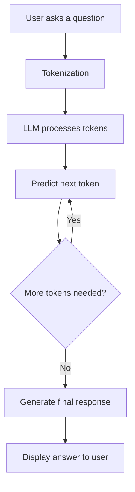

# How Large Language Models (LLMs) Work

## 1. What is an LLM?

A Large Language Model (LLM) is an Artificial Intelligence model
that understands and generates human language.

It is trained using large amounts of text data such as books,
articles, websites and documents.

Examples include GPT, Gemini and Llama.

## 2. How does an LLM work?

An LLM works in the following steps:

1. User Input: The user enters a question or instruction.
2. Tokenization: The text is divided into smaller units called tokens.
3. Model Processing: The model processes tokens using neural networks
   and learns relationships between words.
4. Prediction: It predicts the next likely token based on context.
5. Response Generation: It generates tokens one by one to create an answer.
6. Output: The final response is shown to the user.

## 3. LLM Working Diagram



## 4. What is a Token?

A token is a small unit of text processed by an LLM.
It can be a word, part of a word, or punctuation.

For example, a sentence may be divided into multiple tokens.

## 5. What is a Transformer?

A Transformer is a neural network architecture used by
many modern LLMs.

Its attention mechanism helps the model understand the
relationship between different words in a sentence.

## 6. What is the role of Attention?

Attention helps the model focus on important words
depending on the context of the question.

For example, in "What is the gratuity calculation rule?",
the model can identify the relationship between gratuity
and calculation.

## 7. LLMs in ShramikSathi

ShramikSathi is a Labour Rights Assistant designed to help
Indian workers understand labour-related information.

An LLM could help users ask questions in natural language
and receive easy-to-understand explanations.

Our current system uses TF-IDF and Cosine Similarity
to retrieve relevant FAQs from the dataset.
This is information retrieval, not an LLM.

In a future version, an LLM could explain retrieved
official information in simple language.

## 8. Limitations of LLMs

- They can sometimes generate incorrect information.
- They may not know the latest legal updates.
- They can misunderstand unclear questions.
- Their answers should be checked against official sources.

For labour-law information, users should verify important
decisions with official government sources or qualified experts.

## Conclusion

LLMs make human-computer interaction easier by understanding
and generating natural language. They can make ShramikSathi
more conversational, while official labour documents can
help keep its answers reliable.
```

