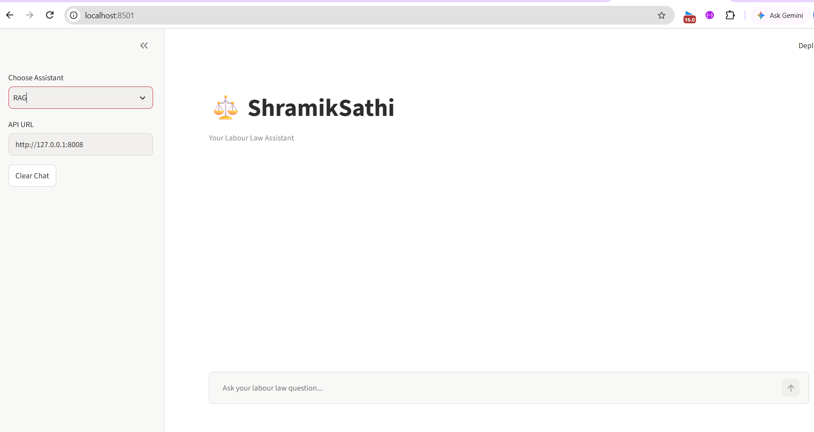
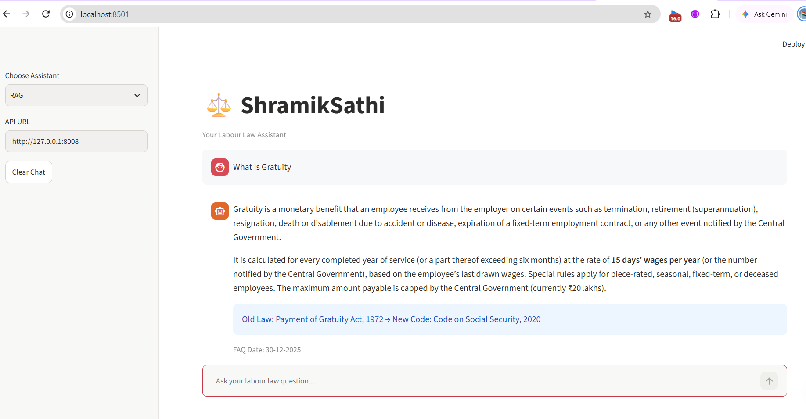
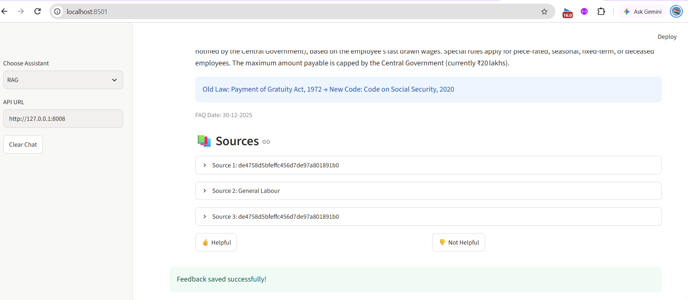
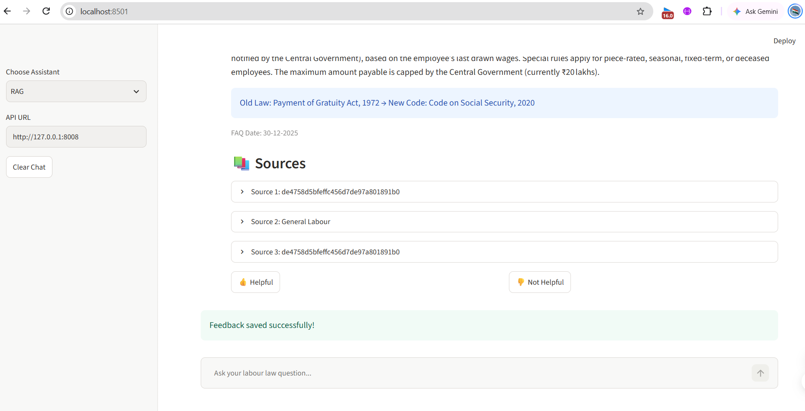
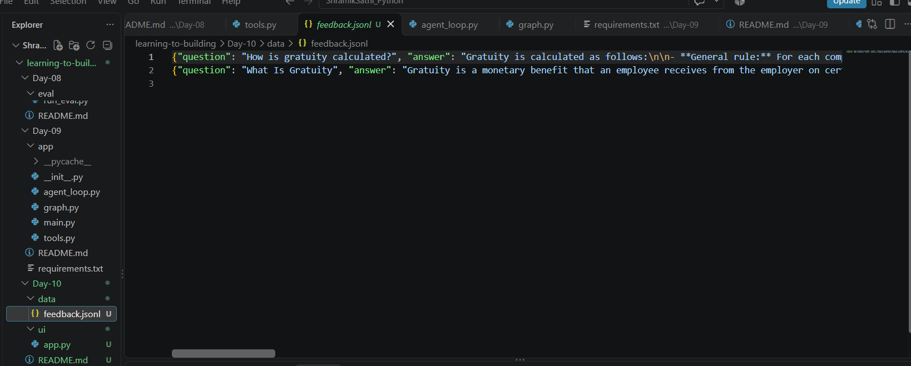

# Day 10 – ShramikSathi Streamlit Chat Interface

## Project Overview
ShramikSathi is an AI-powered labour law assistance system that helps users understand questions related to wages, gratuity, leave, and social security under India's Labour Codes.

Day 10 focuses on building a Streamlit-based chat interface connected to the existing RAG API and AI Agent API.

## Features

- Interactive Streamlit chat interface
- RAG mode for retrieving answers from labour law documents
- AI Agent mode for intelligent question handling
- Old Law → New Code badge displayed with answers
- FAQ date displayed with answers
- Source citations with document name and page number
- Thumbs up / thumbs down feedback system
- Feedback stored in `feedback.jsonl`
- Chat history using Streamlit session state

## Technology Stack

- Python
- Streamlit
- FastAPI
- Requests
- RAG
- ChromaDB
- Groq LLM
- JSON / JSONL

## Project Structure

```text
Day-10/
│
├── data/
│   └── feedback.jsonl
│
├── screenshots/
│   ├── 01_homepage.png
│   ├── 02_ai_answer.png
│   ├── 03_citations.png
│   ├── 04_feedback.png
│   └── 05_feedback_storage.png
│
├── ui/
│   └── app.py
│
└── README.md
```

## How to Run

### 1. Start RAG API

```powershell
uvicorn main:app --app-dir Day-08/app --reload --port 8008
```

### 2. Start AI Agent API

```powershell
uvicorn main:app --app-dir Day-09/app --reload --port 8009
```

### 3. Start Streamlit UI

```powershell
streamlit run Day-10/ui/app.py
```

Open the application in your browser:

```text
http://localhost:8501
```

## Screenshots

### 1. Homepage


### 2. AI Generated Answer


### 3. Answer with Citations


### 4. User Feedback


### 5. Feedback Storage


## Feedback Storage

User feedback is stored in:

```text
Day-10/data/feedback.jsonl
```

Each feedback record contains:

- Question
- Generated answer
- Rating (up/down)
- Timestamp

## Learning Outcomes

- Built an interactive chat interface using Streamlit.
- Connected frontend with FastAPI endpoints.
- Integrated RAG and AI Agent modes.
- Displayed source citations and FAQ dates.
- Implemented a user feedback system.
- Learned how to store feedback in JSONL format.

## Day 10 Status

**Completed – Streamlit Chat Interface and Feedback System**